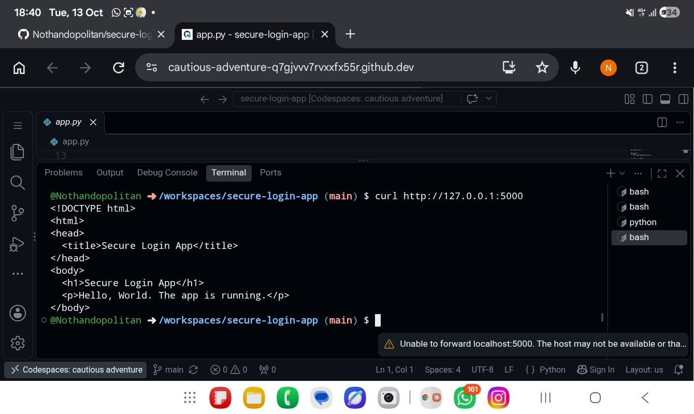

# Daily Log

## 12 Oct
- Created the repo and wrote the full project plan in the README
- Next: set up Codespaces and run a Flask "Hello World"

## 13 Oct
- Added .gitignore, requirements.txt, app.py and templates/index.html
- Set up Codespaces and ran the Flask app
- Confirmed Hello World with curl (browser port forwarding failed on my tablet)
- Learned: how to use a Codespace and test a web app from the terminal
- 
